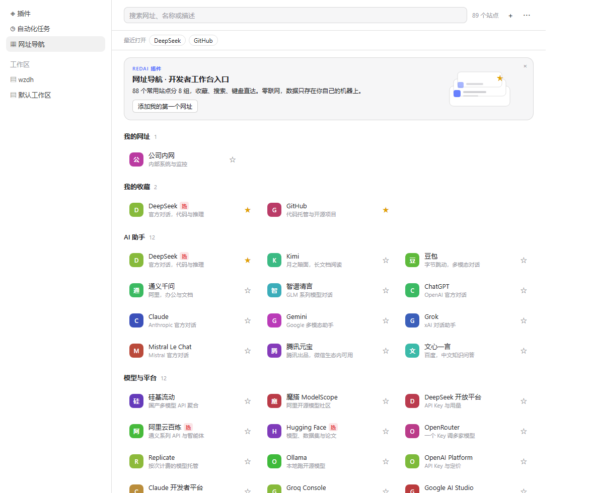
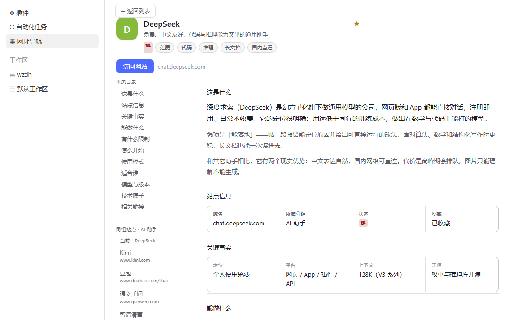
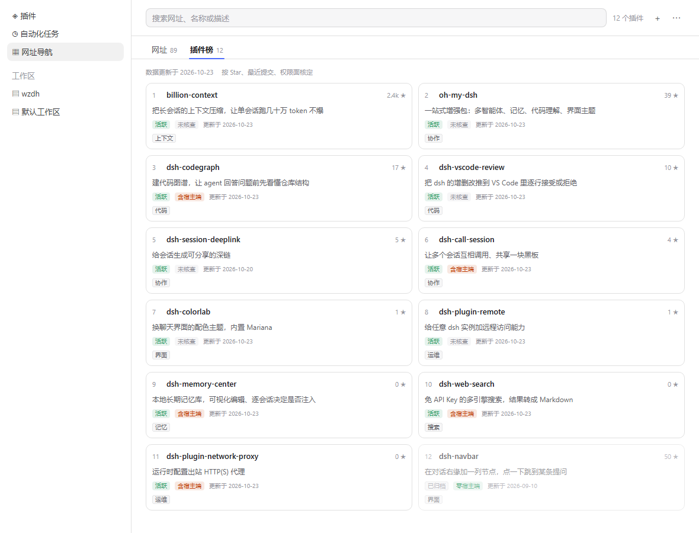

# RedAI 网址导航 · dsh-plugin-redai-nav

> 给 [DeepSeek Harness](https://github.com/deepseek-ai/deepseek-harness) 左侧导航加一个「网址导航」面板：AI 助手、模型平台、开发文档、部署运维、效率工具，一处打开。



**88 个开发者常用站点，分 8 组，按 DSH 用户真正会干的事挑的——不是网址大全。** 搜索、`↑↓`/`Enter` 键盘直达、星标收藏、按分类的前 10 插件榜，都在同一个面板里。

零宿主端代码、零第三方依赖，权限面可逐条验证，见[权限声明](#权限声明)。

## 安装

```bash
dsh plugin --profile desktop add link:/绝对路径/dsh-plugin-redai-nav
```

装完重启客户端，左侧「自动化任务」下方出现「网址导航」。Web 版把 `desktop` 换成 `web`。

> ⚠️ **只能选一种安装方式。** 本包自带 `cordis.patch.yml`（bundle 层注册）。若再手工把同一条 loader 行写进 profile 的 `cordis.patch.yml`，包会被加载两次，导致启动崩溃（社区 STANDARD §6.4 的真实案例）。用官方 CLI 或插件市场安装都会自动处理。

```bash
# 卸载：同时移除 dependencies 与 dsh.profile.bundles 里的条目
dsh plugin --profile desktop remove dsh-plugin-redai-nav
```

## 里面有什么

88 个站点，8 组，按 DSH 用户真实会干的事分的——不是通用导航站：

| 分组 | 内容 | 为谁准备 |
|---|---|---|
| **AI 助手** | DeepSeek、Kimi、豆包、通义千问、智谱清言、腾讯元宝、文心一言、ChatGPT、Claude、Gemini、Grok、Mistral | 选模型、日常问答 |
| **模型与平台** | 硅基流动、魔搭、DeepSeek 开放平台、阿里云百炼、Hugging Face、OpenRouter、Replicate、Ollama、Groq、Google AI Studio … | 接 API、调模型、看定价 |
| **MCP 与插件** | DSH 官网与仓库、`dsh-plugin` 标签、awesome-dsh-plugin、插件市场、mcp.so、Smithery、Glama、MCP 官方 servers | 按 DSH「一切皆插件」的用法扩能力 |
| **开发文档** | MDN、GitHub、npm、PyPI、DevDocs、Node、Python、TypeScript、React、Vite、Can I use、Stack Overflow | 写代码时随手查 |
| **部署与运维** | Vercel、Cloudflare、Netlify、Railway、Fly.io、Supabase、Docker Hub、阿里云、腾讯云、状态页 | 上线、查故障 |
| **效率工具** | IT-Tools、regex101、JSON Crack、CyberChef、crontab.guru、transform.tools、Hoppscotch、draw.io、Excalidraw … | 不写脚本就能解决的小事 |
| **资讯与榜单** | 机器之心、量子位、LMArena、Artificial Analysis、Hacker News、Simon Willison | 跟模型迭代、比价格能力 |
| **设计参考** | Dribbble、Behance、站酷、花瓣、Mobbin、Awwwards、iconfont、Google Fonts、Coolors … | 做界面、找素材 |

分组依据来自 DSH 的官方定位与真实用户构成：官方列的四类任务是「整理资料分析表格、写代码改仓库、查资料核对信息、装插件扩能力」；用户主要是开发者/工程师、数据分析、知识工作者和插件作者。所以这里放的是 API 网关、MCP 目录、模型榜单——而不是「网址大全」。

搜索框支持按名称、描述、域名过滤；`↑` `↓` 移动选中项、`Enter` 打开、`Esc` 清空。输入后输入框右缘会出现 `×`，点它同样清空，且焦点留在输入框里可以接着打字（输入框是普通 `text`，不再带浏览器自带的清除按钮，因此一次 Esc 只会清一次）。卡片点击在右侧栏浏览器打开，不打断当前会话。最近打开过的站点以 chip 排在顶部，最多 8 个。

**收藏**：每张卡片右侧有星标，未收藏是灰色空心 `☆`、已收藏是金色实心 `★`；收藏后在「我的网址」下方出现「我的收藏」分组。**站点详情**：点卡片直接打开站点；卡片右侧的 `ⓘ`（hover 或用方向键选中时出现）进详情页。

详情页按「判断路径」组织，不是介绍海报：**这是什么 → 关键事实 → 能做什么 → 有什么限制 → 怎么开始 → 使用模式 → 适合谁 → 模型与版本 → 技术底子 → 相关链接**。面板够宽（≥720px）时左侧出现 sticky 目录并可跳转，窄面板自动降为单栏；页脚标注信息整理日期，过期内容不装新。**状态标签**：`热` 来自榜单数据，`新` 由 `addedAt` 自动计算（30 天内）。



还可以保存自己的收藏：右上角 `+` 新建（名称 + 网址），自定义站点单独成组、hover 出现删除按钮；`⋯` 里可导出 JSON、导入 JSON（支持本插件导出格式、`links.json`、以及裸数组）、清空本地数据（两段式确认）。

首屏有一条介绍本插件的通栏位，`×` 关掉后不再出现（状态存在本地）。

站点图标按名称本地生成色块——**不请求任何 favicon 服务**，不会把收藏列表泄露给第三方。

> 清单里部分境外站点在受限网络下不可直连，属正常现象；插件本身不做任何连通性探测。

## 权限声明

dsh 的宿主端插件与主进程同权限（可读凭据、全部会话、任意文件）。本插件刻意把能力面压到最小，三条都能被验证：

| 项 | 事实 | 怎么验证 |
|---|---|---|
| **零宿主端代码** | `lib/index.js` 只有一个空 `apply() {}` | 全文 15 行，读一遍即可 |
| **源码即产物** | 源码位于 `src/` 四个模块，`npm run build` 拼装成 `lib/client.js`；产物不压缩、无第三方依赖、无混淆，浏览器执行的就是仓库里可读的代码 | 无 dependencies / devDependencies，`files` 只发产物与运行期数据，`src/` 与 `scripts/` 不进包 |
| **构建方式** | 零依赖拼装脚本（`scripts/build.mjs`，约 100 行读文件 + 缩进 + 拼接），**不是** bundler | 没有 `esbuild`/`rollup`/`webpack` 之类的痕迹；脚本改动 `git diff` 一眼看得完 |
| **联网策略** | 当前版本不发任何出网请求；将来引入联网能力时，域名与用途会先写进 `disclosure.network`，CI 拦未申报的请求 | `disclosure.network` 与 CI 门禁 |
| **不进模型** | 不注册工具、不拼提示词、不做 AI 分类 | 无 `ctx.tools` 注册 |
| **数据不出本机** | 收藏与最近打开只写 `localStorage`，键 `redai-nav:store:v1` | 「⋯ → 清空本地数据」可一键清除 |

内置清单随包发布、只读；用户数据只有三类：自定义站点、星标收藏、最近打开（最多 8 条），都在 `localStorage` 里。

需要知道的三个事实：

- **明文存储**：Chromium 的 localStorage 是 LevelDB，本机明文，不加密。插件不做任何加密——加了也是自欺欺人（密钥同样在本地）。
- **按 origin 隔离**：数据跟着客户端窗口走。换一台机器、换一个客户端、或换浏览器配置，收藏不跟着走——要搬运用「导出 JSON」。这是设计选择：不联网就不会有同步。
- **卸载不清数据**：卸载插件只移除 loader 行，浏览器里的 key 还在；重装后收藏会回来。要彻底清除，先点「清空本地数据」再卸载。

`package.json` 的 `dsh.disclosure` 按社区 DISCLOSURE v0.2 契约声明：`cloud: false`、`network: []`、`offlineMode: true`、`apiKeys: []`、`retention: "none"`、`permissions` 含 `storage:localStorage`、法域 `PIPL`。`network` 记录的是**当前**状态；引入联网能力时会随版本同步更新。

## 兼容性

| 项 | 值 |
|---|---|
| 开发验证版本 | `0.2.1-rc.2`（build `332895e`） |
| `engines.dsh` | `>=0.2.1-rc.2 <0.3.0` |
| 客户端形态 | Web / Desktop 通用（`dsh.client.platform = "web"`） |
| 依赖的基线模块 | `react`、`react/jsx-runtime` |
| 依赖的宿主约定 | 暗色由 `body[data-ds-dark-theme]` 切换（宿主不声明 `color-scheme`，本插件按该属性自钉 `color-scheme`）。若宿主改名，表现是「暗色下取亮色值」而非崩坏 |

`dsh` 处于 developer preview，会带破坏性变更。本插件只依赖两个公开插槽（`sidebar.panellist`、`main`）和最小基线模块，以降低碎裂面。

## 维护清单

`data/links.json` 是**唯一数据源**，`src/data.js` 由脚本生成（`lib/client.js` 是它的拼装产物），两者都不要手改。

```bash
npm run build         # src/*.js → lib/client.js（零依赖拼装，不压缩）
npm run data          # 把 data/*.json 嵌入 src/data.js，生成 locale/*.json，再拼装 lib/client.js
npm run data:check    # CI：检查 src/data.js 与 lib/client.js 是否过期
npm test              # 无客户端环境下的插槽注册 + 渲染冒烟测试
npm run preview       # 生成 preview/index.html（静态预览，不必重启客户端）
```

> 改完 `src/` 一定要 `npm run build` 再提交，否则 `npm run data:check` 会红。

> 改完代码仍需重载客户端才能生效：bundle 模块不在 HMR 的监听根里（profile 的 `hmr` 行默认 `root: []`）。

清单 schema（`version: 1`）：

```json
{
  "version": 1,
  "sources": [{ "id": "webstack", "name": "WebStackPage", "url": "…", "license": "MIT" }],
  "groups": [
    {
      "id": "ai-chat",
      "title": "AI 助手",
      "titleEn": "AI Assistants",
      "source": "webstack",
      "links": [{ "title": "DeepSeek", "url": "https://chat.deepseek.com/", "desc": "官方对话，代码与推理", "hot": true, "addedAt": "2026-10-01" }]
    }
  ]
}
```

`hot`（布尔）与 `addedAt`（`YYYY-MM-DD`）都是可选字段：`hot` 决定是否显示 `热` 标签，`addedAt` 决定是否显示 `新` 标签（30 天内）。

加一个站点 = 改 JSON + `npm run data`，不需要懂 React。

「导出 JSON」产出 `{ version, exportedAt, links[], starred[] }`；「导入 JSON」同时接受这个格式、`links.json`（任意分组，会被拍平）、以及裸数组。导入按 URL 去重，重复导入同一份文件不会产生副本。

### 热 / 新标签怎么来

**`新`是自动的**：`addedAt` 在 30 天内就显示，新增站点只要写日期，过期自动消失，不需要维护。

**`热`不是实时统计**，这一点必须说清楚。当前版本不采集任何点击行为，拿不到"所有用户的点击次数"——这是隐私选择，不是能力限制。可选的做法有这么几种（后三种都要联网或服务端）：

| 做法 | 数据来源 | 代价 | 是否推荐 |
|---|---|---|---|
| **编辑/社区榜单**（当前实现） | `links.json` 的 `hot` 字段，靠 PR 更新 | 更新有延迟，是主观判断 | ✅ 现在用这个 |
| 本地点击计数 | 本机 `localStorage` | 只代表"你自己"，不能叫"热门"，应改叫「常用」 | ⭕ 可作为下一步 |
| 自愿上报 + 仓库汇总 | 用户导出本地统计、手动提交 issue，维护者定期合成 `hot.json` | 样本少、流程重、有滞后 | ⭕ 用户量起来后再说 |
| 半自动（Agent 生成） | 维护者用 agent 抓公开榜单/搜索结果写回文件 | 抓取在维护者侧，插件仍不联网 | ⭕ 适合定期跑 |
| Opt-in 联网上报 | 自建服务 + 匿名计数 | 要服务端、要隐私政策、要在 `disclosure.network` 里公开域名与用途 | ⭕ 服务端就绪后可做 |

真要统计全量点击，还有一个技术细节值得先想清楚：**不采集 URL 就无法知道"哪个站热门"**。所以匿名方案至少要上报 URL 的哈希 + 计数，并做 k-匿名（样本太小的条目不发布），否则去匿名化很容易。这是自建服务前必须设计的部分。

当前 `links.json` 里的 `hot` 是**演示用的稳定随机值**（按 URL 哈希生成，不会每次刷新变），正式发布前需要替换成真实榜单。维护方式：改 JSON → `npm run data` → 发版。

## 插件榜

面板顶部有两个标签：**网址** / **插件榜**。榜单是增值层——网址解决「去哪」，榜单解决「这个插件靠不靠谱」。



**为什么不放在左侧导航？** 官方已经有一个「插件」页（管理已安装、启用停用），再加一行「插件榜」，两个含“插件”的入口必然打架，而且导航行只会越加越多。放进面板内做第二层，既不加导航项，也直接复用了详情页、搜索和键盘操作。

### 榜是什么

**按分类的前 10 名**，不是一张长列表：

- 11 个分类，其中 9 个默认展开，**「主题与外观」「娱乐」折叠**在 `更多` 后面——这两类量大但和目标用户的相关性低，不折叠会盖住主线。
- 每个分类：第 1 名独立大卡（22px 品牌色 `01`），第 2–10 名 44px 紧凑行；分类节标题右侧写收录总量，节底再写一次「该分类共 N 个」并给「查看全部 →」，直链到来源列表对应锚点。
- 分类筛选条 = `全部` + 9 个分类 + `更多`，每个 chip 上的数字是该分类**在来源列表里的收录总量**（94 就是 94 个，不是这个榜里的 10 个）。
- 顶部一行写清排序依据：`按星标降序 · 已归档沉底 · 更新于 YYYY-MM-DD`。
- 搜索同时作用于分类名和条目名/描述；**命中后不重新编号**——榜的名次是算出来的，搜索只是镜头。

排序规则（脚本实现，数据文件里也写着）：

1. 仓库打了 `dsh-plugin` 或 `deepseek-harness` topic 的排在前面；
2. 组内按 star 降序，同分按最近提交；
3. `archived` 仓库一律沉到本类末尾；
4. 取前 10。

Star 是「有多少人在看」的信号，不是质量证明。所以这个榜只声称「这是该分类里最受关注的十个」，不声称「最好用的十个」——排序依据公开，你不同意可以自己按别的标准去看「查看全部」。

**本榜不区分单点插件与合集**（如 `dsh-web` 这类「插件与皮肤合集」）。合集同样按星标参与排序，因为任何「合集降权」的权重都是主观的，一旦加进去，读者就无法用手上的数据复现这个榜。要辨别类型，看详情页的一句话描述。

### 数据从哪来

| 项 | 说明 |
|---|---|
| 来源列表 | [beancookie/awesome-dsh-plugin](https://github.com/beancookie/awesome-dsh-plugin)（社区维护，按 11 个分类收录全部 DSH 插件） |
| 抓取 | `scripts/build-ranking.mjs`：读列表 README 的 raw markdown 解析分类与条目，再用 GitHub search 接口批量查仓库元信息 |
| 名次 | 全部由脚本算好写进 `data/plugins.json`，运行时只渲染，不重排 |
| 更新 | 手动触发、随版本发布；面板上写「更新于 YYYY-MM-DD」，**不写实时** |
| 运行期 | 插件自身**仍然零出网请求**（`disclosure.network: []`），抓取只在维护者本地跑 |

清单里每条只保留 API 能证明的事实：`stars` / `forks` / `pushed` / `created` / `archived` / `language` / `license` / `homepage` / `topics`，加上来源列表给的一句话描述。**没有 `why` / `highlights` / `caveats`** —— v1 那 12 条是手写的编辑意见，换成 500 条收录后不可能逐条编，也不该编。详情页的「为什么在这」由条目自己的数据拼出来：

> 本类第 3 名（该分类共 94 个）· 23 星 · 最近一次提交 10-21 · 未归档 · 已标注 DSH 相关 topic

全是可核对的事实，没有一句是猜的。

### 怎么提 PR

两种加法，别混：

- **让插件上榜**：去 [beancookie/awesome-dsh-plugin](https://github.com/beancookie/awesome-dsh-plugin) 提 PR，在对应分类下加一行 `- [名称](仓库链接) — 一句话描述`。顺手给自己的仓库打上 `dsh-plugin` topic：不打不会被排除，但会排在已标注的条目之后。
- **改本站的榜单**（分类、排序、展示方式）：给本仓库提 PR，改 `scripts/build-ranking.mjs` 或 `src/plugins.js`，跑 `node scripts/build-ranking.mjs --offline && npm test` 保证自洽，再跑一次真实抓取并提交 `data/plugins.json` 的 diff。

### 抓取脚本与 CI

```bash
node scripts/build-ranking.mjs            # 真实抓取并写回（约 7 分钟，会打印每类命中/死链）
node scripts/build-ranking.mjs --offline  # 不联网：schema、排序、rank 连续、与内联副本是否一致
```

**(a) 请求量**：约 500 个仓库，`q=repo:a/b repo:c/d …` 每批 10 个，共约 50 次 search 请求（未认证 **10 次/分钟**，间隔 7s）。另外 search 查不到的那 30 条会各发一次**核心 API** 请求（未认证 **60 次/小时**，间隔 1.1s）——这两个配额是分开算的。设了 `GITHUB_TOKEN` 后 5000 次/小时，两处间隔都降到 0.2s（token 只以长度出现在输出里）。

核心额度不够时脚本**直接失败**（等一个小时不叫"跑一次脚本"），不会写半份数据；报错会告诉你还需要等几分钟。

**(b) 整批 422 就二分**：批次里只要有一个仓库改名/删除，search 会整批拒绝。脚本二分到单条，单条仍失败的记为死链。

**(c) 死链才不进榜，改名要跟**：search 接口的 `repo:` 过滤**不跟随重命名**，仓库一改名就查不到，看起来和删除一模一样。所以批次里查不到的那几条会再走一次 `GET /repos/{owner}/{name}`（fetch 跟随 301），拿到 `full_name` 当新名入榜；**只有 404 才算死链**。0.9.0 第一次抓取把 20 条改名误判成死链，榜首因此少了 `dsh-browser` 892★ 这类条目。

三种情况分开记在 `data/ranking-warnings.json`：`dead`（真 404）、`renamed`（`{from, to, stars}`，已按新名入榜）、`forks`（同名不同 owner，保留星标高者）。

**(d) 失败不覆盖**：抓取中途失败直接非零退出，`data/plugins.json` 一个字不动。半个新榜比旧榜更危险。

**(e) CI 只跑 `--offline`**：外部 API 和配额不该拦 PR。`ci.yml` 里数据校验那一步就是 `node scripts/build-ranking.mjs --offline`——离线、确定性、能复现。

### 数据结构

`data/plugins.json` 是**生成物，别手改**（改了也会被 `--offline` 的规范形式检查打回）：

```json
{
  "version": 2,
  "updatedAt": "2026-10-23",
  "source": {
    "list": "https://github.com/beancookie/awesome-dsh-plugin",
    "method": "类内按星标降序；已归档沉底；未标注 topic 的排在已标注之后",
    "rateLimit": "未经认证的 search 接口，10 次/分钟"
  },
  "categories": [
    {
      "id": "ui",
      "name": "UI 增强",
      "nameEn": "UI",
      "hidden": false,
      "anchor": "#-ui-增强",
      "total": 84,
      "listed": 94,
      "tagged": 84,
      "items": [
        {
          "rank": 1,
          "full": "0xsline/dsh-spotlight",
          "title": "dsh-spotlight",
          "repo": "https://github.com/0xsline/dsh-spotlight",
          "desc": "键盘优先的命令面板（command palette）",
          "stars": 23,
          "forks": 4,
          "pushed": "2026-10-21",
          "created": "2026-08-31",
          "archived": false,
          "tagged": true,
          "language": "TypeScript",
          "license": "MIT",
          "homepage": null,
          "topics": ["dsh-plugin"]
        }
      ]
    }
  ]
}
```

- `total` 是该分类**真正能进榜的数量**：来源列表条目减去死链与重复 fork 之后，还活着的仓库数。节标题写「榜上 10 / 收录 84」，chip 上的数字也是它。
- `listed` 是来源列表里该分类的原始条目数（含死链与 fork），只用于审计——不显示给用户。
- `tagged` 是 `total` 里打了 DSH topic 的数量。它必须和 `total` 同口径，否则「10 已标注 / 13 收录」会被读者理解成「3 个未标注」，而真相往往是「3 条死链」。
- `items` 每类最多 10 条，`rank` 从 1 连续；已归档的在末尾，未标注 topic 的在已标注之后——这两条是 `--offline` 硬校验。
- `hidden` 表示默认折叠，`anchor` 是来源 README 里的锚点，用来拼「查看全部 →」的链接。

### 语言范围

界面文案（标签、字段名、按钮、空状态、分类名）中英双语；插件描述保留来源列表的中文原文，英文 locale 下不做字段级翻译——和站点详情同样的产品决定，不是漏翻。

## 站点详情

`data/details.json` 按站点 URL 索引，给「不够知名」的站点补一段可读的介绍，让人看完才愿意点。字段：

```json
{
  "version": 1,
  "sites": {
    "https://chat.deepseek.com/": {
      "tagline": "一句话定位",
      "tags": ["免费", "代码"],
      "intro": ["第一段", "第二段"],
      "scenarios": [{ "icon": "💻", "title": "写代码", "desc": "一句说明" }],
      "steps": ["第一步", "第二步"],
      "links": [{ "label": "官网", "url": "https://…" }]
    }
  }
}
```

有详情的站点在卡片右侧多一个 `ⓘ` 入口，主点击一律直接打开；没有详情的站点不显示 `ⓘ`。`data:check` 之外，测试还会校验每个详情页都指向真实存在的站点。

## 国际化

`data/i18n.json` 是字典源，脚本同时写到 `locale/zh.json`、`locale/en.json` 并内联进 bundle。运行期通过 `ctx.locale.register(NS, …)` 注册，导航行标签是 locale-aware 函数，切换语言时由 shell 重新取值。

新增语言：在 `data/i18n.json` 的 `locales` 加一份字典（键集与 `zh` 一致），跑 `npm run data`。

## 目录

```
package.json          # dsh.bundle / dsh.client / engines.dsh / disclosure 声明
cordis.patch.yml      # 往组合里插入一条 loader 条目
lib/index.js          # 宿主端空壳（无行为）
lib/client.js         # 生成物：侧栏入口 + 页面（由 src/ 拼装，勿手改）
src/store.js          # helpers + localStorage store（纯函数，无 React）
src/components.js     # 站点卡片 / Banner / 站点详情 / 计数器 / 站点与动效 CSS
src/plugins.js        # 插件榜（分类节 / 第 1 名大卡 / 2–10 紧凑行 / 详情页）与插件榜 CSS
src/page.js           # NavPage + 侧栏图标 + inject/apply + exports（唯一的 React 依赖面）
src/data.js           # 生成物：data/*.json 的内联快照
data/links.json       # 站点清单（唯一数据源）
data/details.json     # 站点详情（可选，按 URL 索引）
data/plugins.json     # 插件榜（schema v2，生成物；含来源、排序依据、每类前 10）
data/ranking-warnings.json  # 生成物：死链与同名 fork 的人工复核清单
data/i18n.json        # 字典（唯一数据源）
locale/*.json         # 由脚本生成
docs/screenshot.png   # 列表页截图
docs/detail.png       # 站点详情截图
docs/plugins.png      # 插件榜截图
docs/plugin-detail.png
scripts/build.mjs     # 零依赖拼装：src/*.js → lib/client.js
scripts/embed-data.mjs
scripts/build-ranking.mjs   # 排行榜抓取脚本（仅维护者本地跑，运行期不联网；CI 只跑 --offline）
scripts/preview.mjs   # 静态预览：--plugins / --detail / --plugin-detail
test/smoke.mjs
```

## 为什么是插件，而不是改安装包

`app.asar` 里的内置包一改就会被 nightly 自动更新覆盖，且重打包有把客户端弄坏的风险。bundle 插件走官方扩展路径：插件页能装能卸，官方安装目录一个字节不动。

## 路线图

- [x] M0 骨架：侧栏入口 + 占位页
- [x] M1 页面：搜索、分组、开发者向站点清单、中英字典、静态预览
- [x] M2 数据：本地收藏、导入导出、清空（`localStorage`）
- [x] M3 交互：`↑↓` 选择 / `Enter` 打开 / `Esc` 清空、最近打开 chip、自动聚焦搜索
- [x] M4 内容：首屏介绍位、星标收藏、站点详情页、hot/new 标签
- [x] M5 选品：按 DSH 用户画像重排为 8 组 88 站，新增 MCP 与插件、资讯与榜单
- [x] M6 增值：插件榜 + 插件详情页
- [x] M6.1 榜单 v2：来源改为 awesome-dsh-plugin，11 个分类各取前 10，排序依据公开、死链不进榜
- [ ] M7 分发：npm 发布、自托管插件市场索引、`dsh-plugin` topic、awesome 收录
- [ ] M8 扩展：右侧栏自定义 tab 类型、`/nav` 命令、网址/工作区/命令三合一入口
- [ ] M9 可选：本地「常用」计数（hot 仍保持榜单制，暂不做联网统计）

## License

MIT。设计参考类站点整理自 [WebStackPage](https://github.com/WebStackPage/WebStackPage.github.io)（MIT）。
