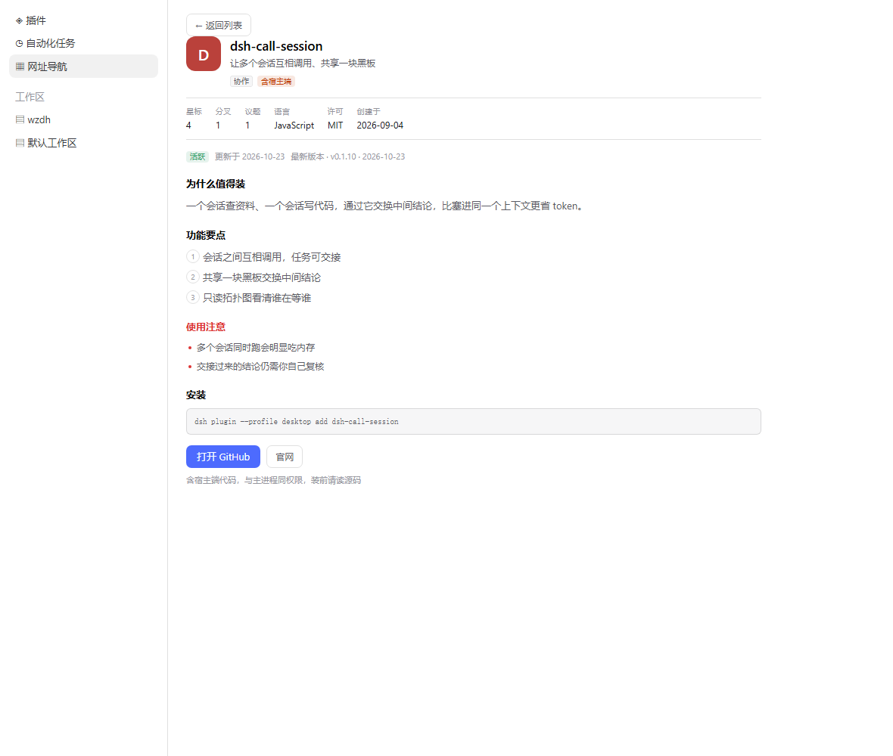

# RedAI 网址导航 · dsh-plugin-redai-nav

> 给 [DeepSeek Harness](https://github.com/deepseek-ai/deepseek-harness) 左侧导航加一个「网址导航」面板：AI 助手、模型平台、开发文档、部署运维、效率工具，一处打开。


**88 个开发者常用站点，分 8 组，按 DSH 用户真正会干的事挑的——不是网址大全。** 搜索、`↑↓`/`Enter` 键盘直达、星标收藏、12 条插件榜，都在同一个面板里。

零宿主端代码、零第三方依赖，权限面可逐条验证，见[权限声明](#权限声明)。

## 安装

```bash
dsh plugin --profile desktop add link:/绝对路径/dsh-plugin-redai-nav
```

装完重启客户端，左侧「自动化任务」下方出现「网址导航」。Web 版把 `desktop` 换成 `web`。

> ⚠️ **只能选一种安装方式。** 本包自带 `cordis.patch.yml`（bundle 层注册）。若再手工把同一条 loader 行写进 profile 的 `cordis.patch.yml`，包会被加载两次，导致启动崩溃（社区 STANDARD §6.4 的真实案例）。用官方 CLI 或插件市场安装都会自动处理。

```bash
# 卸载：同时移除 dependencies 与 dsh.profile.bundles 里的条目
dsh plugin --profile desktop remove dsh-plugin-redai-nav
```

## 里面有什么

88 个站点，8 组，按 DSH 用户真实会干的事分的——不是通用导航站：

| 分组 | 内容 | 为谁准备 |
|---|---|---|
| **AI 助手** | DeepSeek、Kimi、豆包、通义千问、智谱清言、腾讯元宝、文心一言、ChatGPT、Claude、Gemini、Grok、Mistral | 选模型、日常问答 |
| **模型与平台** | 硅基流动、魔搭、DeepSeek 开放平台、阿里云百炼、Hugging Face、OpenRouter、Replicate、Ollama、Groq、Google AI Studio … | 接 API、调模型、看定价 |
| **MCP 与插件** | DSH 官网与仓库、`dsh-plugin` 标签、awesome-dsh-plugin、插件市场、mcp.so、Smithery、Glama、MCP 官方 servers | 按 DSH「一切皆插件」的用法扩能力 |
| **开发文档** | MDN、GitHub、npm、PyPI、DevDocs、Node、Python、TypeScript、React、Vite、Can I use、Stack Overflow | 写代码时随手查 |
| **部署与运维** | Vercel、Cloudflare、Netlify、Railway、Fly.io、Supabase、Docker Hub、阿里云、腾讯云、状态页 | 上线、查故障 |
| **效率工具** | IT-Tools、regex101、JSON Crack、CyberChef、crontab.guru、transform.tools、Hoppscotch、draw.io、Excalidraw … | 不写脚本就能解决的小事 |
| **资讯与榜单** | 机器之心、量子位、LMArena、Artificial Analysis、Hacker News、Simon Willison | 跟模型迭代、比价格能力 |
| **设计参考** | Dribbble、Behance、站酷、花瓣、Mobbin、Awwwards、iconfont、Google Fonts、Coolors … | 做界面、找素材 |

分组依据来自 DSH 的官方定位与真实用户构成：官方列的四类任务是「整理资料分析表格、写代码改仓库、查资料核对信息、装插件扩能力」；用户主要是开发者/工程师、数据分析、知识工作者和插件作者。所以这里放的是 API 网关、MCP 目录、模型榜单——而不是「网址大全」。

搜索框支持按名称、描述、域名过滤；`↑` `↓` 移动选中项、`Enter` 打开、`Esc` 清空。输入后输入框右缘会出现 `×`，点它同样清空，且焦点留在输入框里可以接着打字（输入框是普通 `text`，不再带浏览器自带的清除按钮，因此一次 Esc 只会清一次）。卡片点击在右侧栏浏览器打开，不打断当前会话。最近打开过的站点以 chip 排在顶部，最多 8 个。

**收藏**：每张卡片右侧有星标，未收藏是灰色空心 `☆`、已收藏是金色实心 `★`；收藏后在「我的网址」下方出现「我的收藏」分组。**站点详情**：点卡片直接打开站点；卡片右侧的 `ⓘ`（hover 或用方向键选中时出现）进详情页。**状态标签**：`热` 来自榜单数据，`新` 由 `addedAt` 自动计算（30 天内）。


还可以保存自己的收藏：右上角 `+` 新建（名称 + 网址），自定义站点单独成组、hover 出现删除按钮；`⋯` 里可导出 JSON、导入 JSON（支持本插件导出格式、`links.json`、以及裸数组）、清空本地数据（两段式确认）。

首屏有一条介绍本插件的通栏位，`×` 关掉后不再出现（状态存在本地）。

站点图标按名称本地生成色块——**不请求任何 favicon 服务**，不会把收藏列表泄露给第三方。

> 清单里部分境外站点在受限网络下不可直连，属正常现象；插件本身不做任何连通性探测。

## 权限声明

dsh 的宿主端插件与主进程同权限（可读凭据、全部会话、任意文件）。本插件刻意把能力面压到最小，三条都能被验证：

| 项 | 事实 | 怎么验证 |
|---|---|---|
| **零宿主端代码** | `lib/index.js` 只有一个空 `apply() {}` | 全文 15 行，读一遍即可 |
| **源码即产物** | 源码位于 `src/` 四个模块，`npm run build` 拼装成 `lib/client.js`；产物不压缩、无第三方依赖、无混淆，浏览器执行的就是仓库里可读的代码 | 无 dependencies / devDependencies，`files` 只发产物与运行期数据，`src/` 与 `scripts/` 不进包 |
| **构建方式** | 零依赖拼装脚本（`scripts/build.mjs`，约 100 行读文件 + 缩进 + 拼接），**不是** bundler | 没有 `esbuild`/`rollup`/`webpack` 之类的痕迹；脚本改动 `git diff` 一眼看得完 |
| **联网策略** | 当前版本不发任何出网请求；将来引入联网能力时，域名与用途会先写进 `disclosure.network`，CI 拦未申报的请求 | `disclosure.network` 与 CI 门禁 |
| **不进模型** | 不注册工具、不拼提示词、不做 AI 分类 | 无 `ctx.tools` 注册 |
| **数据不出本机** | 收藏与最近打开只写 `localStorage`，键 `redai-nav:store:v1` | 「⋯ → 清空本地数据」可一键清除 |

内置清单随包发布、只读；用户数据只有三类：自定义站点、星标收藏、最近打开（最多 8 条），都在 `localStorage` 里。

需要知道的三个事实：

- **明文存储**：Chromium 的 localStorage 是 LevelDB，本机明文，不加密。插件不做任何加密——加了也是自欺欺人（密钥同样在本地）。
- **按 origin 隔离**：数据跟着客户端窗口走。换一台机器、换一个客户端、或换浏览器配置，收藏不跟着走——要搬运用「导出 JSON」。这是设计选择：不联网就不会有同步。
- **卸载不清数据**：卸载插件只移除 loader 行，浏览器里的 key 还在；重装后收藏会回来。要彻底清除，先点「清空本地数据」再卸载。

`package.json` 的 `dsh.disclosure` 按社区 DISCLOSURE v0.2 契约声明：`cloud: false`、`network: []`、`offlineMode: true`、`apiKeys: []`、`retention: "none"`、`permissions` 含 `storage:localStorage`、法域 `PIPL`。`network` 记录的是**当前**状态；引入联网能力时会随版本同步更新。

## 兼容性

| 项 | 值 |
|---|---|
| 开发验证版本 | `0.2.1-rc.2`（build `332895e`） |
| `engines.dsh` | `>=0.2.1-rc.2 <0.3.0` |
| 客户端形态 | Web / Desktop 通用（`dsh.client.platform = "web"`） |
| 依赖的基线模块 | `react`、`react/jsx-runtime` |
| 依赖的宿主约定 | 暗色由 `body[data-ds-dark-theme]` 切换（宿主不声明 `color-scheme`，本插件按该属性自钉 `color-scheme`）。若宿主改名，表现是「暗色下取亮色值」而非崩坏 |

`dsh` 处于 developer preview，会带破坏性变更。本插件只依赖两个公开插槽（`sidebar.panellist`、`main`）和最小基线模块，以降低碎裂面。

## 维护清单

`data/links.json` 是**唯一数据源**，`src/data.js` 由脚本生成（`lib/client.js` 是它的拼装产物），两者都不要手改。

```bash
npm run build         # src/*.js → lib/client.js（零依赖拼装，不压缩）
npm run data          # 把 data/*.json 嵌入 src/data.js，生成 locale/*.json，再拼装 lib/client.js
npm run data:check    # CI：检查 src/data.js 与 lib/client.js 是否过期
npm test              # 无客户端环境下的插槽注册 + 渲染冒烟测试
npm run preview       # 生成 preview/index.html（静态预览，不必重启客户端）
```

> 改完 `src/` 一定要 `npm run build` 再提交，否则 `npm run data:check` 会红。

> 改完代码仍需重载客户端才能生效：bundle 模块不在 HMR 的监听根里（profile 的 `hmr` 行默认 `root: []`）。

清单 schema（`version: 1`）：

```json
{
  "version": 1,
  "sources": [{ "id": "webstack", "name": "WebStackPage", "url": "…", "license": "MIT" }],
  "groups": [
    {
      "id": "ai-chat",
      "title": "AI 助手",
      "titleEn": "AI Assistants",
      "source": "webstack",
      "links": [{ "title": "DeepSeek", "url": "https://chat.deepseek.com/", "desc": "官方对话，代码与推理", "hot": true, "addedAt": "2026-10-01" }]
    }
  ]
}
```

`hot`（布尔）与 `addedAt`（`YYYY-MM-DD`）都是可选字段：`hot` 决定是否显示 `热` 标签，`addedAt` 决定是否显示 `新` 标签（30 天内）。

加一个站点 = 改 JSON + `npm run data`，不需要懂 React。

「导出 JSON」产出 `{ version, exportedAt, links[], starred[] }`；「导入 JSON」同时接受这个格式、`links.json`（任意分组，会被拍平）、以及裸数组。导入按 URL 去重，重复导入同一份文件不会产生副本。

### 热 / 新标签怎么来

**`新`是自动的**：`addedAt` 在 30 天内就显示，新增站点只要写日期，过期自动消失，不需要维护。

**`热`不是实时统计**，这一点必须说清楚。当前版本不采集任何点击行为，拿不到"所有用户的点击次数"——这是隐私选择，不是能力限制。可选的做法有这么几种（后三种都要联网或服务端）：

| 做法 | 数据来源 | 代价 | 是否推荐 |
|---|---|---|---|
| **编辑/社区榜单**（当前实现） | `links.json` 的 `hot` 字段，靠 PR 更新 | 更新有延迟，是主观判断 | ✅ 现在用这个 |
| 本地点击计数 | 本机 `localStorage` | 只代表"你自己"，不能叫"热门"，应改叫「常用」 | ⭕ 可作为下一步 |
| 自愿上报 + 仓库汇总 | 用户导出本地统计、手动提交 issue，维护者定期合成 `hot.json` | 样本少、流程重、有滞后 | ⭕ 用户量起来后再说 |
| 半自动（Agent 生成） | 维护者用 agent 抓公开榜单/搜索结果写回文件 | 抓取在维护者侧，插件仍不联网 | ⭕ 适合定期跑 |
| Opt-in 联网上报 | 自建服务 + 匿名计数 | 要服务端、要隐私政策、要在 `disclosure.network` 里公开域名与用途 | ⭕ 服务端就绪后可做 |

真要统计全量点击，还有一个技术细节值得先想清楚：**不采集 URL 就无法知道"哪个站热门"**。所以匿名方案至少要上报 URL 的哈希 + 计数，并做 k-匿名（样本太小的条目不发布），否则去匿名化很容易。这是自建服务前必须设计的部分。

当前 `links.json` 里的 `hot` 是**演示用的稳定随机值**（按 URL 哈希生成，不会每次刷新变），正式发布前需要替换成真实榜单。维护方式：改 JSON → `npm run data` → 发版。

## 插件榜

面板顶部有两个标签：**网址** / **插件榜**。榜单是增值层——网址解决「去哪」，榜单解决「这个插件靠不靠谱」。


**为什么不放在左侧导航？** 官方已经有一个「插件」页（管理已安装、启用停用），再加一行「插件榜」，两个含“插件”的入口必然打架，而且导航行只会越加越多。放进面板内做第二层，既不加导航项，也直接复用了详情页、搜索和键盘操作。

每条记录给的不只是排名，而是**判断依据**：

| 字段 | 作用 |
|---|---|
| `desc` / `why` | 一句话说清解决什么问题、为什么值得装（不是抄仓库简介） |
| `host` | **权限面**：`none` 零宿主端 / `yes` 含宿主端 / `unknown` 未核查 |
| `pushed` | 最近提交日期——比 star 更能说明还在不在维护 |
| `pkg` | 可直接复制的安装目标 |
| `category` | 单个分类词，取值只有 `代码` / `记忆` / `搜索` / `界面` / `协作` / `运维` / `上下文` |
| `highlights` | 3 条、每条 8–20 字的具体能力，不写“功能强大”这种空话 |
| `caveats` | 1–2 条真实使用注意（要不要重启、会不会替换默认工具），没有就空数组 |
| `stars` / `forks` / `issues` | 抓取当日快照（不是实时），三个数字同一口径、同一次请求 |
| `created` | 仓库创建日期，取自 GitHub REST API |
| `archived` / `license` / `language` / `homepage` / `topics` | 同上；`license` 取 `spdx_id`，`NOASSERTION` 归一为 `null` |
| `release` | `{ tag, at }`，来自 `GET /releases/latest`，没有 release 则 `null` |
| `maintained` | 派生字段：`archived` 仓库 → `archived`；`pushed` 距今 > 180 天 → `stale`；否则 `active` |

抓取字段由 `scripts/fetch-plugins.mjs` 写回（维护者本地手动跑，**插件运行期当前不出网**）：它只覆盖上面这批抓取/派生字段（含 `stars` / `forks` / `issues` —— 三者同一口径），`id` / `title` / `pkg` / `repo` / `desc` / `why` / `pushed` / `host` / `tags` / `category` / `highlights` / `caveats` 一律保留；单条请求失败时保留旧值并打印警告，不会把字段清空。

```bash
node scripts/fetch-plugins.mjs          # 抓取并写回 data/plugins.json
node scripts/fetch-plugins.mjs --check  # 只抓取比对，不写文件
```

`--check` 是门禁，不是打印器：文件过期 **或** 本轮有任一条没抓成功（限流、断网、404）都会打印 `unverified N plugin(s)`，但两者用**不同的退出码**，因为要处理的事不一样。

### 抓取脚本与 CI

**(a) 成本**：每次 `--check` 都要联网，12 条 × 2 个请求 = **24 次**。GitHub 未认证配额是 **60 次/小时**，所以匿名状态下每小时最多跑 2 次；设了 `GITHUB_TOKEN` 则是 5000 次/小时。

```bash
GITHUB_TOKEN=ghp_xxx node scripts/fetch-plugins.mjs --check   # 5000 req/h，token 不会出现在任何输出里
```

**(b) 退出码**

| exit | 含义 | 该做什么 |
|---|---|---|
| `0` | 内容与 API 一致，且每条都验证过 | 什么都不用做 |
| `1` | 数据**确实过期**（内容变了），或文件不合规范 | 跑一次写入模式，审 diff，提交 |
| `2` | 本轮**没能验证**（限流 / 断网 / 404），不是数据过期 | 等 reset 窗口、换出口、设 `GITHUB_TOKEN`，或改用 `--offline` |

`1` 优先于 `2`：数据真的过期是「发现」，验证不了只是「没检查」，前者更严重。

**(c) 限流或离线怎么办**
- 限流：警告里带 `resets at <ISO 时间>`，等过那个时间点即可（匿名 60/h 是滚动窗口）
- 换出口 IP 可以立刻重置匿名配额；或者设 `GITHUB_TOKEN` 一劳永逸
- 完全离线（内网 CI）：`node scripts/fetch-plugins.mjs --check --offline`，不联网，只校验 schema、派生字段（`maintained` 与 `archived`/`pushed` 是否自洽）、文件是否规范（键序 / 缩进），以及 **`data/plugins.json` 与 `lib/client.js` 内联副本是否一致**（等价于 `embed-data --check` 的漂移检测）。离线模式不产生 unverified，只会 `exit 0` 或 `1`

**(d) 别把它挂成每个 PR 的硬门禁**：它依赖外部 API 和配额，PR 会被无关的限流搞红。建议做成**每日定时任务**（cron / GitHub Actions schedule），失败时开 issue 而不是拦合并；PR 阶段只跑 `embed-data --check` 和 `test/smoke.mjs`，两者都离线、确定性。

**语言范围**：界面文案（chrome：标签、字段名、按钮、空状态、维护状态等）提供中英双语；插件正文（`desc` / `why` / `highlights` / `caveats`）保留中文原文，英文 locale 下不做字段级翻译——这是本轮的产品决定，不是遗漏。

`host` 是这一列里最值钱的：**dsh 插件跑在主进程内、不在沙箱里**，装一个插件等于把 shell 和文件权限交给它。所以只有核查过的才标 `none`（例如 `dsh-navbar` 的主入口就是一个空 `apply(){}`），没核过的一律 `unknown`——不猜。



### 数据与更新周期

`data/plugins.json`：

```json
{
  "version": 1,
  "updatedAt": "2026-10-23",
  "cadence": "monthly",
  "method": "排序按 Star、最近提交、权限面、可用性四项人工核定；Star / Fork / Issue 数为抓取当日快照",
  "plugins": [
    {
      "id": "dsh-navbar",
      "title": "dsh-navbar",
      "pkg": "@vlln/dsh-navbar",
      "repo": "https://github.com/vlln/dsh-navbar",
      "desc": "在对话右缘加一列节点，点一下跳到某条提问",
      "why": "会话变长后回翻很痛苦。它把每条用户消息画成短横线，滚动位置同步高亮。",
      "pushed": "2026-09-10",
      "host": "none",
      "tags": ["导航", "对话"],
      "category": "界面",
      "highlights": ["右缘一列短横线，点哪条跳哪条", "滚动时高亮跟着走，翻长会话不迷路", "只画导航条，不碰会话内容和权限"],
      "caveats": ["仓库已归档，只读，不再接收更新"],
      "stars": 50,
      "forks": 1,
      "issues": 0,
      "created": "2026-08-10",
      "archived": true,
      "license": "MIT",
      "language": "TypeScript",
      "homepage": null,
      "topics": ["dsh", "dsh-plugin", "plugin", "ui"],
      "release": null,
      "maintained": "archived"
    }
  ]
}
```

已归档的条目在列表里整体降权并沉到末尾，序号按排序后重算——所以看到「第 12 位是已归档」不是排序坏了，而是刻意的：还在维护的东西排前面。

界面上只写「数据更新于 X 月 X 日 · 按月更新」，**不写“实时”**——它不是实时数据，装作实时就是骗人。

`method` 是必填的：排行榜如果不写评选标准，就等于宣称“我们说了算”，用户发现不对劲时会连榜单一起不信。给依据比给结论更重要，这恰好也是解决信息差的核心。

当前 12 条的分类、功能要点与使用注意是人工写的，`host` 由我逐个核查主入口判定；仓库侧的事实（fork、issue、创建日期、许可、最新 release、是否归档）由 `scripts/fetch-plugins.mjs` 刷新，抓不到的字段留 `null` 而不是编一个。

## 站点详情

`data/details.json` 按站点 URL 索引，给「不够知名」的站点补一段可读的介绍，让人看完才愿意点。字段：

```json
{
  "version": 1,
  "sites": {
    "https://chat.deepseek.com/": {
      "tagline": "一句话定位",
      "tags": ["免费", "代码"],
      "intro": ["第一段", "第二段"],
      "scenarios": [{ "icon": "💻", "title": "写代码", "desc": "一句说明" }],
      "steps": ["第一步", "第二步"],
      "links": [{ "label": "官网", "url": "https://…" }]
    }
  }
}
```

有详情的站点在卡片右侧多一个 `ⓘ` 入口，主点击一律直接打开；没有详情的站点不显示 `ⓘ`。`data:check` 之外，测试还会校验每个详情页都指向真实存在的站点。

## 国际化

`data/i18n.json` 是字典源，脚本同时写到 `locale/zh.json`、`locale/en.json` 并内联进 bundle。运行期通过 `ctx.locale.register(NS, …)` 注册，导航行标签是 locale-aware 函数，切换语言时由 shell 重新取值。

新增语言：在 `data/i18n.json` 的 `locales` 加一份字典（键集与 `zh` 一致），跑 `npm run data`。

## 目录

```
package.json          # dsh.bundle / dsh.client / engines.dsh / disclosure 声明
cordis.patch.yml      # 往组合里插入一条 loader 条目
lib/index.js          # 宿主端空壳（无行为）
lib/client.js         # 生成物：侧栏入口 + 页面（由 src/ 拼装，勿手改）
src/store.js          # helpers + localStorage store（纯函数，无 React）
src/components.js     # 站点卡片 / Banner / 站点详情 / 计数器 / 站点与动效 CSS
src/plugins.js        # 插件榜卡片 / 插件详情 / 排名函数 / 插件榜 CSS
src/page.js           # NavPage + 侧栏图标 + inject/apply + exports（唯一的 React 依赖面）
src/data.js           # 生成物：data/*.json 的内联快照
data/links.json       # 站点清单（唯一数据源）
data/details.json     # 站点详情（可选，按 URL 索引）
data/plugins.json     # 插件榜（含更新周期与评选方法）
data/i18n.json        # 字典（唯一数据源）
locale/*.json         # 由脚本生成
docs/screenshot.png   # 列表页截图
docs/detail.png       # 站点详情截图
docs/plugins.png      # 插件榜截图
docs/plugin-detail.png
scripts/build.mjs     # 零依赖拼装：src/*.js → lib/client.js
scripts/embed-data.mjs
scripts/fetch-plugins.mjs  # 抓取脚本（仅维护者本地跑，运行期不联网）
scripts/preview.mjs   # 静态预览：--plugins / --detail / --plugin-detail
test/smoke.mjs
```

## 为什么是插件，而不是改安装包

`app.asar` 里的内置包一改就会被 nightly 自动更新覆盖，且重打包有把客户端弄坏的风险。bundle 插件走官方扩展路径：插件页能装能卸，官方安装目录一个字节不动。

## 路线图

- [x] M0 骨架：侧栏入口 + 占位页
- [x] M1 页面：搜索、分组、开发者向站点清单、中英字典、静态预览
- [x] M2 数据：本地收藏、导入导出、清空（`localStorage`）
- [x] M3 交互：`↑↓` 选择 / `Enter` 打开 / `Esc` 清空、最近打开 chip、自动聚焦搜索
- [x] M4 内容：首屏介绍位、星标收藏、站点详情页、hot/new 标签
- [x] M5 选品：按 DSH 用户画像重排为 8 组 88 站，新增 MCP 与插件、资讯与榜单
- [x] M6 增值：插件榜（12 条，含权限面、维护活跃度、更新周期）+ 插件详情页
- [ ] M7 分发：npm 发布、自托管插件市场索引、`dsh-plugin` topic、awesome 收录
- [ ] M8 扩展：右侧栏自定义 tab 类型、`/nav` 命令、网址/工作区/命令三合一入口
- [ ] M9 可选：本地「常用」计数（hot 仍保持榜单制，暂不做联网统计）

## License

MIT。设计参考类站点整理自 [WebStackPage](https://github.com/WebStackPage/WebStackPage.github.io)（MIT）。
